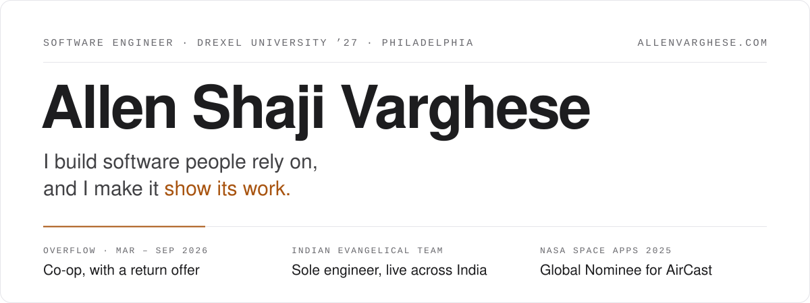
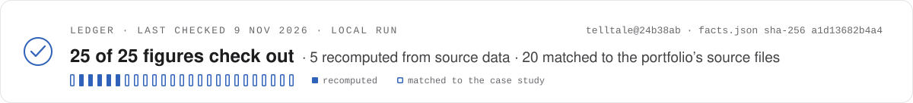

<!--
  Every figure on this page is a link to a fact in facts.json.
  scripts/ledger.py checks them all every Monday (.github/workflows/ledger.yml) and renews the
  stamp only on a full pass. To add a figure: write it as [**N**](receipt "fact:<id> · note")
  and add a matching entry to facts.json. Any other digit fails the check.
-->

<a href="https://allenvarghese.com/projects">
  <picture>
    <source media="(prefers-color-scheme: dark)" srcset="./assets/masthead-dark.svg">
    <source media="(prefers-color-scheme: light)" srcset="./assets/masthead-light.svg">
    
  </picture>
</a>

<p>
  <b><a href="https://allenvarghese.com/projects">Every project, one page&nbsp;→</a></b>
  &nbsp;·&nbsp; <a href="https://allenvarghese.com">The 3D portfolio</a>
  &nbsp;·&nbsp; <a href="https://www.linkedin.com/in/allen-shaji-varghese/">LinkedIn</a>
  &nbsp;·&nbsp; <a href="mailto:allenvarghese05@gmail.com">allenvarghese05@gmail.com</a>
  <!-- CONFIRM résumé: &nbsp;·&nbsp; <a href="https://allenvarghese.com/resume.pdf">Résumé</a> -->
</p>

I'm finishing a B.S. in Software Engineering at Drexel (June 2027), and I build products end to end, from the schema to the last pixel. This year I shipped production code at [Overflow](https://www.overflow.co) and they asked me back with a return offer. I'm the sole engineer on a grant system now live across India, and I built an AI crash investigator that can't publish a claim plain code can't reproduce.

<a href="https://github.com/allenvarghese05/allenvarghese05/actions/workflows/ledger.yml">
  <picture>
    <source media="(prefers-color-scheme: dark)" srcset="./assets/ledger-dark.svg">
    <source media="(prefers-color-scheme: light)" srcset="./assets/ledger-light.svg">
    
  </picture>
</a>

<sub>I hold this page to Telltale's rule. Every figure below links to its source, and every Monday a GitHub Action I wrote re-checks them all before it renews the stamp above. <a href="#how-this-page-checks-itself">How it works</a></sub>

## Selected work

###  Telltale

<sub>META GLOBAL AI DEVELOPER HACKATHON 2026 · INDIE TRACK · SOLO · OCT – NOV 2026</sub>

Meta AI investigates a car crash from dashcam video and the car's logs. SAM 3.1 tracks the vehicles, a Muse Wonder agent measures every interval with a tool, and then a plain Python checker recomputes every claim and the verdict from a SHA-256-hashed evidence store. Anything it can't prove never reaches the report. I also ran it against deleted evidence, a lying witness and instructions planted in the evidence.

[**151**](https://github.com/allenvarghese05/telltale/blob/24b38ab2f45a3cf8d95627fa0dced600f131d989/README.md#L498-L503 "fact:telltale.investigations · matched to the case study") live AI investigations, each checked by code &nbsp;·&nbsp; [**0**](https://github.com/allenvarghese05/telltale/blob/24b38ab2f45a3cf8d95627fa0dced600f131d989/README.md#L432-L437 "fact:telltale.published_wrong · recomputed from the committed benchmark files") wrong verdicts published, [**2**](https://github.com/allenvarghese05/telltale/blob/24b38ab2f45a3cf8d95627fa0dced600f131d989/README.md#L432-L437 "fact:telltale.withheld · recomputed from the committed benchmark files") caught and withheld &nbsp;·&nbsp; danger onsets found on [**65%**](https://github.com/allenvarghese05/telltale/blob/24b38ab2f45a3cf8d95627fa0dced600f131d989/video_bench.json#L6 "fact:telltale.onset_found · recomputed: video_bench.json summary.onset_coverage") of [**400**](https://github.com/allenvarghese05/telltale/blob/24b38ab2f45a3cf8d95627fa0dced600f131d989/video_bench.json#L3 "fact:telltale.clips · recomputed: video_bench.json summary.n_attempted") real crash clips, and [**74%**](https://github.com/allenvarghese05/telltale/blob/24b38ab2f45a3cf8d95627fa0dced600f131d989/video_bench.json#L15 "fact:telltale.onset_2s · recomputed: video_bench.json summary.within_2_0s") of those within two seconds of the human label

[Case study](https://allenvarghese.com/projects/telltale) · [Live replay](https://huggingface.co/spaces/Allen05254/telltale) · [Source](https://github.com/allenvarghese05/telltale)<br>
<sub>Python 3.12 · SAM 3.1 · Muse Spark 1.3 · Muse Wonder · NumPy · SciPy · pytest · GitHub Actions</sub>

###  Church Building System

<sub>INDIAN EVANGELICAL TEAM · SOLE ENGINEER · IN PRODUCTION ACROSS INDIA SINCE OCTOBER 2026</sub>

The grant system for building churches across India: apply, review, approve, then fund construction in three phases. A release can never pass the approved amount, even with two clicks at once, and a Super Admin console changes the rules without a deploy. It serves a network of [**3,000+**](https://allenvarghese.com/projects/iet "fact:iet.pastors · matched to the case study") pastors.

[**1.28 s**](https://allenvarghese.com/projects/iet "fact:iet.analytics · private repository; matched to the case study") all-time analytics, down from [**31.4 s**](https://allenvarghese.com/projects/iet "fact:iet.analytics_before · same connection, before the rewrite") on the same connection &nbsp;·&nbsp; [**700+**](https://allenvarghese.com/projects/iet "fact:iet.checks · matched to the case study") automated checks in CI

[Case study](https://allenvarghese.com/projects/iet) · Private client repository, shown with test data<br>
<sub>Next.js · React · TypeScript · PostgreSQL · Prisma · Supabase</sub>

###  AirCast

<sub>NASA SPACE APPS 2025 · GLOBAL NOMINEE · TEAM OF TWO, WITH AAHIL AFRAZ</sub>

Air quality from space to street: NASA TEMPO satellite data, ground sensors and weather on one map, with safety advice per group. My part was the AI brief and chat, the per-group safety engine, the forecast explanations, getting the satellite data onto Azure, and the deploy pipeline.

One of [**1,219**](https://allenvarghese.com/projects/aircast "fact:aircast.nominees · matched to the case study") Global Nominees out of [**11,500+**](https://allenvarghese.com/projects/aircast "fact:aircast.teams · matched to the case study") teams &nbsp;·&nbsp; [**19**](https://allenvarghese.com/projects/aircast "fact:aircast.my_commits · matched to the case study") of the [**27**](https://allenvarghese.com/projects/aircast "fact:aircast.hack_commits · matched to the case study") hackathon commits are mine

[Case study](https://allenvarghese.com/projects/aircast) · [Source](https://github.com/aahilafraz123/aircast-nasa-hackathon) (my teammate's repository)<br>
<sub>Python · Flask · NASA TEMPO · GPT-4o-mini · Azure App Service and Blob Storage · GitHub Actions</sub>

###  Typist-ML

<sub>A TYPING COACH BUILT AS A FAIR EXPERIMENT · SOLE RESEARCHER AND ENGINEER</sub>

Four ways to drill my weakest letter pairs: plain practice as the control, a dictionary heuristic, an order-3 character Markov chain, and Llama 3.2 1B running on my laptop through mlx-lm. Every drill passes one fairness gate, and the analysis plan was committed before any results.

[**25,022**](https://allenvarghese.com/projects/typist-ml "fact:typist.keystrokes · pilot data stays local; matched to the case study") keystrokes in the pilot &nbsp;·&nbsp; errors fell from [**16.8%**](https://allenvarghese.com/projects/typist-ml "fact:typist.err_before · matched to the case study") to [**5.4%**](https://allenvarghese.com/projects/typist-ml "fact:typist.err_after · matched to the case study") &nbsp;·&nbsp; [**652**](https://allenvarghese.com/projects/typist-ml "fact:typist.tests · pytest and Vitest") automated tests. In this one-person, unblinded pilot the targeted drills came out even with plain practice, and the write-up says so.

[Case study](https://allenvarghese.com/projects/typist-ml) · [Source](https://github.com/allenvarghese05/typist-ml)<br>
<sub>Python 3.12 · FastAPI · SQLModel · SQLite · React · TypeScript · mlx-lm</sub>

**Also:** [BIS Report Card](https://allenvarghese.com/projects/bis-report-card), self-hosted CBSE report cards for a school in Madhya Pradesh, one server and no cloud, with [**282**](https://allenvarghese.com/projects/bis-report-card "fact:bis.tests · private repository, green in CI") automated tests (built; rollout with the school in talks) &nbsp;·&nbsp; [LearnFlow AI](https://allenvarghese.com/projects/learnflow-ai), the student planner I co-founded, whose first version reached [**150+**](https://allenvarghese.com/projects/learnflow-ai "fact:learnflow.testers · beta testers on v1") beta testers ([live](https://learnflow-ai.app/)) &nbsp;·&nbsp; In progress: [Chronos](https://allenvarghese.com/projects/chronos-ai), an iOS and server wake detector, and [AutoMix](https://allenvarghese.com/projects/automix-ai), real-time acoustic feedback suppression

<sub>Code you can read: [Telltale](https://github.com/allenvarghese05/telltale) · [Typist-ML](https://github.com/allenvarghese05/typist-ml) · [AutoMixAI](https://github.com/allenvarghese05/AutoMixAI) · [this page's checker](./scripts/ledger.py). The client systems are private; their case studies show them with test data.</sub>

## Experience

**Overflow** · Software Engineering Co-op · Mar – Sep 2026 · Philadelphia, remote · *return offer*<br>
A giving platform for churches, ministries and nonprofits that moves [**$100M+**](https://allenvarghese.com/projects#experience "fact:overflow.volume · Overflow's public figure") in donations a year. I was the sole engineer on the move from Zendesk to Pylon's AI support chatbot across [**4**](https://allenvarghese.com/projects#experience "fact:overflow.surfaces · matched to the portfolio") surfaces, worked on the stock-gift pipeline that handles [**9**](https://allenvarghese.com/projects#experience "fact:overflow.formats · matched to the portfolio") brokerage formats, and shipped [**100+**](https://allenvarghese.com/projects#experience "fact:overflow.commits · matched to the portfolio") commits in a React, Node.js and MongoDB monorepo, including [**3**](https://allenvarghese.com/projects#experience "fact:overflow.features · matched to the portfolio") gift-correction features announced company-wide.

> <sub>“He really does ship like crazy.” · Engineering, Overflow, at the team demo of the internal tools I built</sub>

**Indian Evangelical Team** · Software Solutions Architect · Jan 2026 – present · sole engineer on the Church Building System<br>
**Beersheba International School** · Sole developer · Jul – Oct 2026 · BIS Report Card<br>
**LearnFlow AI** · Co-founder · Jun 2025 – present<br>
**Drexel University** · B.S. Software Engineering · class of June 2027

## Tools I reach for

TypeScript · Python · JavaScript · SQL · React · Next.js · Node.js · Express · NestJS · FastAPI · PostgreSQL · Prisma · MongoDB · Docker · GitHub Actions<br>
<sub>AI and ML: OpenAI GPT-4o · Meta AI (Muse, SAM 3.1) · Llama 3.2 on-device with mlx-lm · NumPy · SciPy · OpenCV &nbsp;·&nbsp; Testing: pytest · Vitest · Jest · Playwright</sub>

<!-- CONFIRM AZ-900: **Certified:** [Microsoft Azure Fundamentals (AZ-900)](CREDENTIAL_SHARE_LINK) -->

## How this page checks itself

Hover any figure and its title names a fact in [`facts.json`](./facts.json). Every Monday, [`scripts/ledger.py`](./scripts/ledger.py) (plain Python, standard library only) runs three checks, and the stamp above is renewed only if every one passes. A failure stamps nothing.

<details>
<summary><b>The three checks</b></summary>
<br>

- **Recompute.** Telltale's figures are derived again from the benchmark JSON committed to its repo, read at a pinned commit. The script sums the verified-but-wrong verdicts across every benchmark file and must get the same number you read above.
- **Match.** Each figure's wording must also appear on [allenvarghese.com/projects](https://allenvarghese.com/projects), so this page can never say more than my case studies. The client and employer work is private, so for those figures the match is the check, and the stamp counts them separately from the recomputed ones.
- **Cite.** Any figure in this README that isn't a link to a fact is blocked, so a number can't slip in without a source.

```json
{
  "id": "telltale.onset_2s",
  "display": "74%",
  "kind": "recomputed",
  "recompute": { "repo": "allenvarghese05/telltale", "op": "json_path",
                 "file": "video_bench.json", "path": "summary.within_2_0s", "as": "percent" },
  "proof": ["74%", "danger onsets within 2 s of human labels"]
}
```

It's the rule from Telltale's checker, applied to my own front page. [Run history](https://github.com/allenvarghese05/allenvarghese05/actions/workflows/ledger.yml)

</details>

<sub>Open to new-grad roles in applied AI, forward-deployed engineering and full-stack, starting 2027. Email is the quickest way to reach me: [allenvarghese05@gmail.com](mailto:allenvarghese05@gmail.com)</sub>
